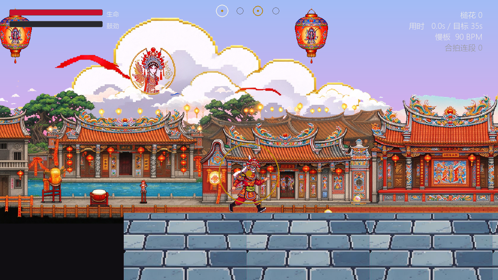
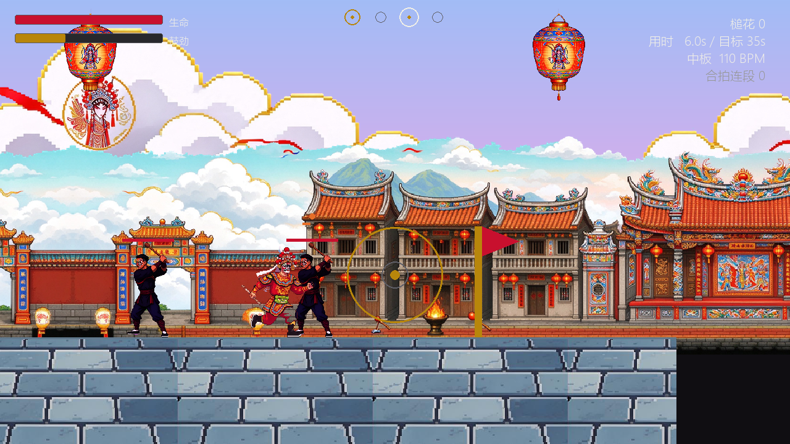
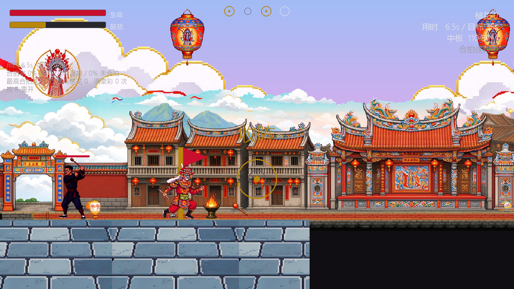

# 踏鼓 / Project Drumbeat

**英歌舞主题横版动作闯关游戏** —— 潮汕英歌舞非遗数字化传承与创新实践（第 8 小组）

> 一句话：一款「跟着锣鼓鼓点打」的横版闯关游戏。鼓点是节拍器，合拍是伤害倍率。

---

## 画面预览

实际运行截图（由 `drumbeat-m0/tools/preview.py` 无窗口渲染生成）：







> 画面仍在迭代中：背景层采用镜像拼接已消除平铺接缝，但会有对称重复感；`远景层` 素材尚未启用。

---

## 一、项目简介

玩家扮演英歌队的槌手，踩着锣鼓鼓点一路巡游、挥槌破阵。游戏把「英歌舞的节奏感」翻译成可上手的操作：踩准判定点出招，伤害倍率更高；踩不准仍保留音效与判定反馈，但空挥不给伤害。

设计四条支柱：

- **鼓点驱动**：音频时钟是唯一时间基准，帧率波动不影响判定结果
- **合拍即爽点**：踩准判定点出招有明确倍率与即时反馈
- **跑打无缝**：跑酷态与战斗态共享同一套位移参数，切换不重置速度
- **文化不失真**：动作、鼓点、场景均能在潮汕英歌中找到依据

当前进度：**M0 可玩原型已完成并验证通过**（单赛段可通关、合拍判定跑在音频时钟上），像素素材包已处理并落位，下一步按《游戏策划案》的 M1 开始接入素材。

---

## 二、目录结构

```
TRAE_WORK_data_YingGe/
├─ drumbeat-m0/                 游戏工程（Python + pygame）
│  ├─ run.py                    开发运行入口
│  ├─ build.ps1                 PyInstaller 打包脚本
│  ├─ 踏鼓M0.spec               PyInstaller 规格文件
│  ├─ drumbeat/                 游戏代码包
│  │  ├─ app.py                 主循环与运行时装配（含调试/手感面板、日志导出）
│  │  ├─ audio.py               音频时钟与混音引擎（含无设备降级）
│  │  ├─ synth.py               程序化锣鼓合成（六件乐器 + 反馈音）
│  │  ├─ tempo.py               分层离散换板与鼓点前瞻调度
│  │  ├─ judgement.py           合拍判定核心（按键帧锚点）
│  │  ├─ motion.py              固定步长运动与 AABB 碰撞
│  │  ├─ combat.py              帧数据战斗状态机与对击弹反
│  │  ├─ energy.py              鼓劲槽与满堂彩
│  │  ├─ level.py               赛段、障碍与敌人
│  │  ├─ inputs.py              统一输入抽象层
│  │  ├─ hud.py                 渲染、HUD、节拍可视化、调试/手感面板
│  │  ├─ config.py              数据加载与全局常量
│  │  └─ data/                  五张数据表（JSON）
│  ├─ assets/                   像素素材（角色/敌人/环境/UI）
│  │  ├─ characters/player/     玩家：run_0..3、charge、jump、death
│  │  ├─ characters/enemy/      敌人：idle、walk、attack1、attack2、block、defeat_0..2
│  │  ├─ environment/           天空、云朵、远景层、前景层、ground_tile、level_map
│  │  ├─ ui/                    胜负结算图
│  │  └─ manifest.json          素材清单（尺寸、抠图色、缩放倍率、调色板）
│  └─ tools/
│     ├─ smoke_test.py         无窗口冒烟测试（核心链路 + 面板自检）
│     └─ preview.py            渲染预览：无窗口跑一段并存 PNG，便于验收美术与镜头
├─ docs/                        全部文档
│  ├─ 策划案/                    游戏策划案（md / json / docx）、豆包像素提示词套件、第 8 小组策划案
│  ├─ 设计文档/                  详细设计文档、合拍判定与节拍表、ADR-001、英歌融合方案、早期玩法设计
│  ├─ 进度与验收/                项目进度.md、M0 任务清单、M0 开发状态、美术素材需求清单
│  └─ screenshots/              画面预览截图（README 展示用，可由 preview.py 重新生成）
├─ art-source/picture/          原始素材包（AI 生成，品红底）
├─ archive/                     历史归档（初版横版跑酷策划案、原稿备份）
├─ tools/                       文档工具（Markdown → DOCX）
│  ├─ package.json              依赖声明（docx）
│  └─ md2docx.js                转换脚本
```

---

## 三、快速开始

### 1. 环境准备

需要 Python 3.10 或以上，依赖四个库：

```bash
python -m pip install pygame numpy sounddevice pyinstaller
```

> `pyinstaller` 仅打包时需要；日常运行不需要。

### 2. 运行游戏

```bash
cd drumbeat-m0
python run.py
```

### 3. 冒烟测试（不开窗口，速验核心链路）

```bash
cd drumbeat-m0
python tools/smoke_test.py
```

它会用合成音频时钟 + 会看路的机器人跑完整个赛段，并自检渲染与面板，最后打印 `SMOKE: PASS`。验证标准：赛段通关、敌人全清、完美率 ≥75%、Δt 均值绝对值 ≤30ms、面板无异常。

### 4. 打包为可直接运行的 exe

```bash
cd drumbeat-m0
powershell -ExecutionPolicy Bypass -File build.ps1
```

产物在 `drumbeat-m0/dist/`。

> **打包注意**：本机 `pyinstaller` 命令可能指向另一个未安装 sounddevice 的 Python 环境，导致打出的 exe 无声。`build.ps1` 已固化为 `python -m PyInstaller` 并显式加 `--collect-all sounddevice`，请勿手改这一行。

---

## 四、操作说明

- `A` / `D` —— 左右移动
- `空格` —— 跳跃（支持二段跳）
- `J` —— 攻击（**合拍判定的锚点按键**）
- `L` 或 `Shift` —— 抢步
- `S` —— 矮子步（低姿通过悬空横梁）
- `F` —— 满堂彩（鼓劲满且合拍连段 ≥4 时可用）
- `F1` —— 判定调试面板（Δt / 判定等级 / 连段 / BPM / 拍相位 / 音频延迟）
- `F2` —— 手感参数面板（↑↓ 选择，←→ 调整，实时生效）
- `F3` —— 显示/隐藏帮助
- `P` 暂停 / `R` 重开
- `1` `2` `3` `4` —— 强制切换板式（慢板 / 中板 / 快板 / 极板）
- `ESC` —— 退出（退出时自动导出试玩日志）

---

## 五、数据表（改数值不改代码）

所有数值都在 `drumbeat/data/` 下的 JSON 里，调平衡不用碰代码：

| 文件 | 内容 |
| --- | --- |
| `feel_params.json` | 手感参数：运动、辅助、战斗、判定窗口、鼓劲槽 |
| `tempo_layers.json` | 四档板式定义与分层离散切换规则 |
| `beat_tables.json` | 各板式的锣鼓事件表与判定点位置 |
| `frame_data.json` | 招式帧数据（startup / active / recovery / 取消窗口） |
| `level_segment.json` | 关卡布局（地面、平台、陷阱、悬空横梁、敌人） |

关键约定（来自 ADR-001，勿随意改）：

- 判定锚点固定为**按键帧**，判定反馈在按键帧立即触发；伤害倍率只在攻击实际命中时结算
- 板式 BPM：慢板 90 / 中板 110 / 快板 140 / **极板 150**（上限 150，待非遗传承人确认）
- 板式**分层离散切换**，只在小节边界换板，层内允许 ±8% 微调
- 判定点固定落在每小节的**第 1、3 拍**

---

## 六、美术素材

### 1. 风格规范

- **像素风**（16-bit 取向）：清晰像素块 + 硬边描边，无抗锯齿、无模糊
- 角色与背景均来自 AI 生成（豆包 Seedream），提示词见 `docs/策划案/project-drumbeat-doubao-pixel-prompt-kit.md`
- 调色板锁定 24–32 色，主色：英歌红 `#D11430`、粉白 `#FBEFF3`、金 `#D4A017`、夜蓝 `#12203A`、青绿 `#2E7D6B`
- 渲染尺度建议：`PIXELS_PER_UNIT = 80`，屏幕 1280×720，可见世界 16×9 单位，角色高约 **149px**

### 2. 抠图规则（重要）

原始素材是**品红底**（`#FF00FF`；部分经 JPEG 压缩后偏玫红 `#E00060`）。抠图必须遵守：

- 用**边界泛洪填充**：只删除与画面边缘连通的底色，再清除被角色包围的残余
- 清除残余按「B 通道远大于 G 通道」判定，**不要用全局色阈值**
- **背景层不做粉色清除**：天空的粉霞、建筑的粉墙是画作本身，误删会挖出空洞
- **`level_map`（完整关卡地图）是整幅全景图、没有品红底**：它只能「从上方边缘泛洪、并收紧容差」去掉天空；若从四边全部泛洪，会把下方广场砖栏的灰蓝色像素一并误删，在游戏里变成透出天空底色的空洞
- 角色红色戏服 `#D11430`（B 通道低）不会被上述规则误伤

### 3. 缩放与对齐规则

- 同族素材必须用**同一整数倍**下采样，保证比例一致（否则跪姿、倒地帧会被放大）：
  玩家 1/6、敌人 1/10
- 只做「朝右」方向，程序按 `facing` 水平翻转
- 角色以**脚底中心**为原点对齐地面，画布底部居中
- 统一 PNG-32 透明底

### 4. 命名规范（新素材请遵守）

- 玩家：`characters/player/<state>[_帧序号].png`（state 用 `idle` / `run` / `jump` / `attack` / `parry` / `slide` / `hurt` / `death`）
- 敌人：`characters/enemy/<state>[_帧序号].png`
- 环境：`environment/<层名>.png`（建议后续统一改为 ASCII 名，如 `sky.png` / `cloud_1.png` / `far_1.png` / `fore_1.png`）
- UI：`ui/<名称>.png`

### 5. 素材缺口（用提示词套件补齐）

| 类别 | 缺什么 |
| --- | --- |
| 玩家动作 | idle、挥槌三段、凌空挥槌两段、劈山、对击、矮子步、抢步、受击、满堂彩 |
| 场景道具 | 尖刺、悬空横梁、单向平台、坑洞边缘、收阵门楼 |
| HUD | 判定圈、4 拍鼓面图标、生命/鼓劲槽框、判定图章、满堂彩就绪图标 |
| 关卡与音频 | L2/L3 背景层、Boss 与远程鼓师、四档板式锣鼓循环、反馈音 |

已有素材的预览图：`assets/_preview_player.png`、`_preview_enemy.png`、`_preview_ui.png`。

---

## 七、玩法系统摘要

- **合拍判定**：按键帧锚点，完美 ±40ms / 合拍 ±80ms，由音频时钟驱动
- **锣鼓板式**：慢板 90 / 中板 110 / 快板 140 / 极板 150 BPM，仅在小节边界换板
- **运动手感**：固定步长 1/120s；疾行、腾跃、二段跳、抢步、矮子步
- **帧数据战斗**：挥槌三段、凌空挥槌两段、劈山、对击；取消窗口在 recovery 后 40%
- **对击弹反**：敌人命中前 100ms 内按攻击触发，成功硬直并加鼓劲
- **鼓劲槽与满堂彩**：疾行、命中、合拍倍率、弹反叠加；满槽且连段 ≥4 释放

---

## 八、开发方式（AI 协作纪律）

本工程采用 **Trae + AI 模型辅助编程**，请遵守四条纪律：

1. **一次只提一个明确目标**，不要一次提一堆需求
2. **优先改 JSON 数据表**，代码改动尽量小，降低回归风险
3. 涉及美术时，**先给素材文件名与规格**，再让 AI 写贴图加载层
4. **每次改动后必须实跑一次并记录**，避免「看起来改好了、其实没跑通」

小循环：描述需求 → 让 AI 改代码/数据 → 本地实跑 → 记录问题 → 让 AI 修复 → 再运行验证。

---

## 九、常见问题

- **没有声音？** 音频设备不可用时会自动降级为 `NullAudioEngine`（判定仍可跑通，仅无声音）。若打包后无声，见第三节的「打包注意」。
- **想快速自动跑一遍？** 设置环境变量 `DRUMBEAT_SMOKE_FRAMES=600`，游戏会跑 600 帧后自动退出并导出日志。
- **试玩数据在哪？** 退出后在 exe / 工程目录生成 `playtest_log.csv`（逐条判定）与 `playtest_summary.csv`（判定分布、Δt 均值、音频引擎状态）。
- **想调手感？** 直接开 `F2` 面板边玩边调，或改 `drumbeat/data/feel_params.json`。

---

## 十、相关文档

- 项目进度与问题清单：`docs/进度与验收/项目进度.md`
- 游戏策划案（可读版）：`docs/策划案/project-drumbeat-game-design-proposal.md`
- 游戏策划案（DOCX 版）：`docs/策划案/project-drumbeat-game-design-proposal.docx`
- 游戏策划案（结构化数据版）：`docs/策划案/project-drumbeat-game-design-proposal.json`
- 豆包像素素材提示词套件：`docs/策划案/project-drumbeat-doubao-pixel-prompt-kit.md`
- 第 8 小组课程策划案：`docs/策划案/潮汕英歌舞非遗数字化传承与创新实践_第8小组策划案(1).docx`
- 详细设计文档：`docs/设计文档/project-drumbeat-detailed-design-document.json`
- 合拍判定与节拍表：`docs/设计文档/project-drumbeat-beat-judgement-tables.json`
- 判定锚点与 BPM 决策记录：`docs/设计文档/project-drumbeat-decision-ADR-001.json`
- M0 任务清单：`docs/进度与验收/project-drumbeat-m0-prototype-tasklist.json`
- M0 开发状态与验证结果：`docs/进度与验收/project-drumbeat-m0-build-status.json`
- 美术素材需求清单：`docs/进度与验收/project-drumbeat-art-asset-manifest.json`

---

## 十一、文档工具（Markdown → DOCX）

策划案以 Markdown 维护，需要提交时导出为 DOCX。转换脚本固化在 `tools/`，改完 md 一条命令即可重新导出。

首次使用先装依赖（Node.js 环境）：

```bash
cd tools
npm install
```

导出：

```bash
cd tools
npm run docx -- ../docs/策划案/project-drumbeat-game-design-proposal.md ../docs/策划案/project-drumbeat-game-design-proposal.docx
```

脚本支持多级标题、无序列表（2 空格缩进为二级）、有序列表、表格、代码块、引用与行内 `**粗体**` / `` `代码` ``。版式为 A4、页边距 1 英寸、中文用 Microsoft YaHei，标题带大纲级别（Word 导航窗格可跳章）。

> 说明：`tools/node_modules/` 是本地依赖目录，可随时删除后用 `npm install` 重建，无需提交。

---

## 十二、开发辅助工具

### 1. 渲染预览（无窗口出图）

无窗口跑一段赛段并把画面存成 PNG，用来快速验收美术、镜头与图层效果：

```bash
cd drumbeat-m0
python tools/preview.py preview_out 14
```

会在 `preview_out/` 下按时间点输出 `t000.0.png`（同场景另有 `_debug` / `_feel` 面板版本），以及结算时的 `state_cleared.png`。

### 2. 美术接入现状（M1）

- **视差层顺序**：天空渐变（取色自 `天空.png`）→ 云层 `云朵_2` → 中景 `level_map`（祠堂街景，仅去天空）→ 砖地 `ground_tile` → 角色 / 敌人 → 前景灯笼 `前景层_1`
- **角色与敌人**已改用像素贴图；**缺图自动回退**程序化绘制（把 `assets/` 改名后游戏仍能正常运行、冒烟测试仍 PASS）
- **渲染尺度**：`PIXELS_PER_UNIT = 80`，角色屏幕高约 149px
- 层配置集中在 [hud.py](file:///d:/AI_APP/TRAE_WORK_data_YingGe/drumbeat-m0/drumbeat/hud.py) 顶部的 `PARALLAX_LAYERS` / `FOREGROUND_LAYER`（视差系数、缩放、锚点、平铺间距），改这几个数即可微调构图
- **已知限制**：背景层用「镜像拼接」（相邻瓦片左右翻转）消除接缝，代价是对称重复感；`远景层` 四张素材已就位但当前配置未启用（与中景层重叠，留待 M2 做真正的分层远景）；中景层天空区仍有少量未清除的残留贴片
